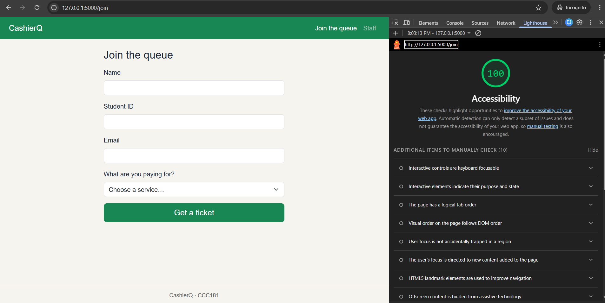
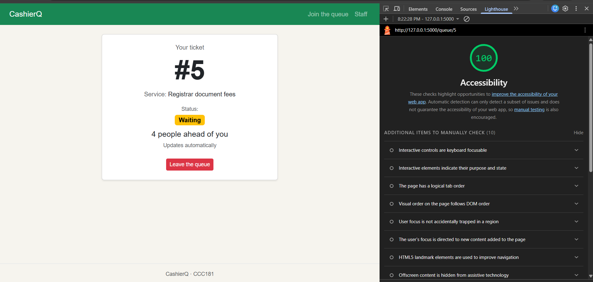
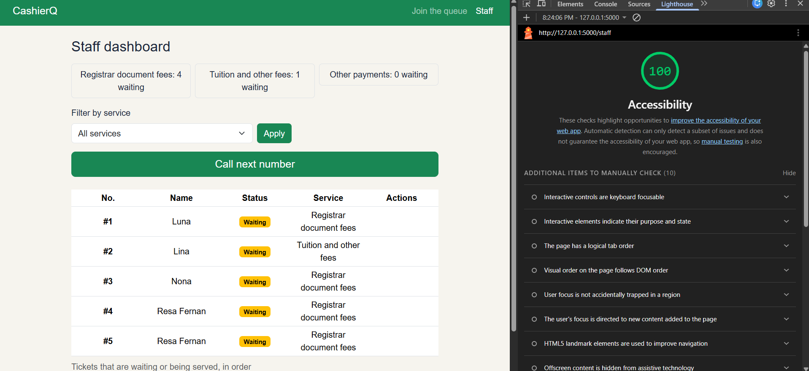

# Week 3 accessibility check

## 9a. Lighthouse (Accessibility, Mobile)

| Screen | Score |
| --- | --- |
| Join | 100 |
| My place | 100 |
| Staff dashboard | 100 |

No failed audits were reported on any screen, so no fixes were needed.

 

 

## 9b. Keyboard-only test

I tested with Tab, Shift+Tab, Enter, Space and the arrow keys, without the mouse. I joined the queue from the home page, and on the staff dashboard I filtered by a service, called a ticket and marked it Done. The "Skip to main content" link appeared on the first Tab, I could always see where the focus was, and I could reach and use every control. Nothing failed, so no fixes were needed.

## 9c. Manual checklist

| Check | Join | My place | Staff |
| --- | --- | --- | --- |
| Every input has a visible label | ✅ | ✅ (no inputs) | ✅ |
| Error messages say what to do, in text | ✅ | ✅ (no form errors) | ✅ (no form errors) |
| Status is shown in words, not only color | ✅ (no status shown) | ✅ | ✅ |
| Text and buttons are readable at 375 px with no sideways page scroll | ✅ | ✅ | ✅ |
| Buttons are at least about 44 × 44 px on a phone | ✅ | ❌ then ✅ | ❌ then ✅ |
| Page has one `<h1>` and headings in order | ✅ | ✅ | ✅ |
| `<html lang="en">` is set | ✅ | ✅ | ✅ |

**Fixes made:**
- Some buttons (Leave the queue, Done, No-show and Apply) were too small to tap easily on a phone. I made every button at least 44 px tall by adding one rule to `style.css`.
- On a phone, the "No-show" button text was splitting into two lines in the staff table. I fixed it so the label stays on one line.
