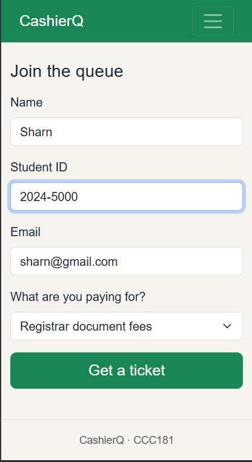
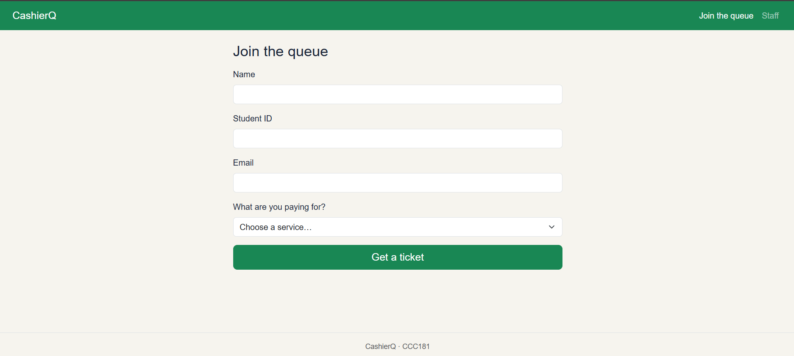
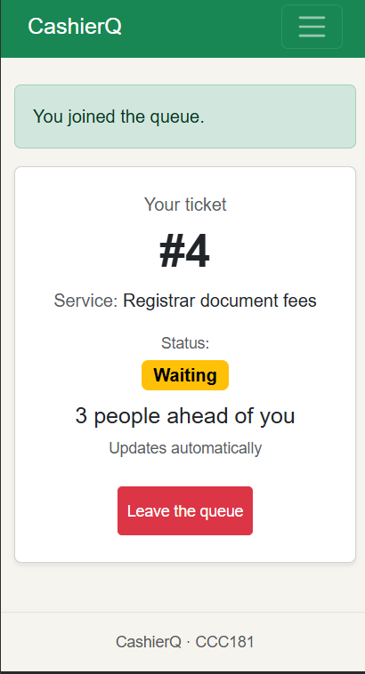
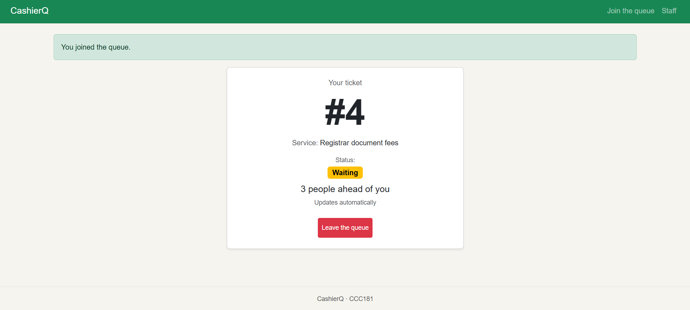
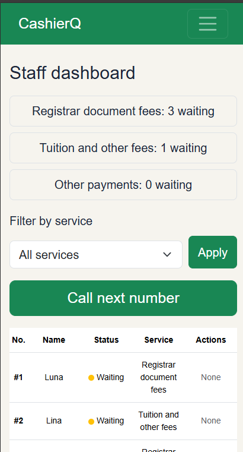
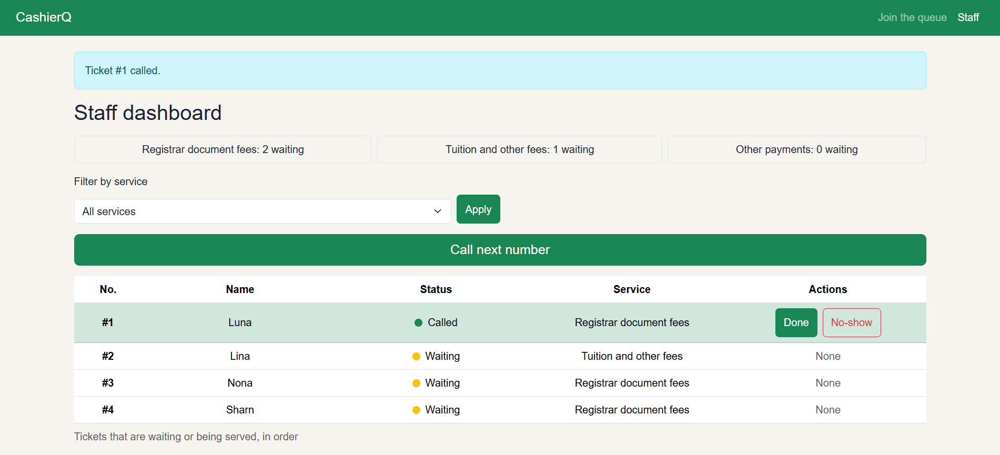

# CashierQ: Week 3 Report

## 1. Title details

- **App:** CashierQ
- **Setting:** School cashier office, especially during enrollment week
- **Name:** Pauline N. Fernan
- **Student ID:** 2024-0037
- **Section:** CS3B
- **Date:** October 25, 2026
- **Pull request:** https://github.com/paulinefernan0901-dotcom/CCC181/pull/2

## 2. Personas

Full information for the two personas are in found in [personas.md](personas.md).

**Dona, the person waiting (21 years old, 3rd-year student).**
> "I only needed to pay for one document, but I waited in line much longer than I expected." *(interview)*

Top tasks: join the queue (FR-01), check her number and people ahead (FR-02), know when she is called without refreshing (FR-03), leave the queue (FR-04).

**Teresa, the cashier (45 years old).**

Top tasks: see the waiting list in order (FR-05), call the next student (FR-06), mark served (FR-07), mark no-show (FR-08), filter by service (FR-09).

## 3. Screens

Dona uses this on her phone between classes. It covers FR-01.

Dona uses this on a laptop while sitting on a bench. It covers FR-01.

Dona checks her ticket here while walking. It covers FR-02, FR-03 and FR-04.

Dona checks her ticket here in the library. It covers FR-02, FR-03 and FR-04.

Teresa can use this on a smartphone. It covers FR-05 to FR-09.

Teresa uses this at the cashier counter. It covers FR-05 to FR-09.

## 4. Design decisions

1. **The ticket number is the largest thing on My place.** Dona checks her phone while walking with one hand free, so she needs to read her number at a glance (Dona rule 1).
2. **"Call next number" is the biggest button on the staff dashboard, above the table.** Teresa does it all day, and it was hard to see in my first wireframe (Teresa rule 1, and my self-review).
3. **The Join form has only four fields.** Dona is busy and wants to get a ticket fast, so I only ask for name, student ID, email and the service (Dona rule 4).

## 5. Self-review

I went through all three screens at phone and laptop width as Dona and Teresa would use them. The full review is in [feedback.md](feedback.md). 

A summary of my self-review:

On the Join screen, the service names didn't match across my wireframes, so I made them all use the same three services as the app. On My place, nothing told Dona the page refreshes on its own, and the Leave button was easy to tap by accident, so I added an "Updates automatically" line and made Leave red and smaller. On the staff dashboard, "Call next" was tucked below the table in grey even though it's what Teresa uses most, so I moved it above the table and made it green.

## 6. Accessibility

Lighthouse accessibility scores: 

Join 100/100

My place 100/100

Staff 100/100

Full results are in [accessibility.md](accessibility.md).

The most important fix was making every button at least 44 px tall, because Leave the queue, Done, No-show and Apply were too small to tap easily on a phone. I also stopped the "No-show" label from splitting onto two lines when the UI is changed into a phone version.

## 7. Usability test

One student tested the app on a laptop and finished all three tasks without help, although there was a slight pause when the user tried the staff dashboard.

| Task | Finished? | Time | Notes |
|---|---|---|---|
| 1. Join the queue | Yes | About 1 minute | No hesitation |
| 2. Find number and people ahead | Yes | A few seconds | No hesitation |
| 3. Call next and mark served | Yes | 46 seconds | Paused briefly at the many controls, then figured it out |

**Improvement:** 

In Task 3 the tester paused for a few seconds because the colored "Waiting" and "Called" badges looked like buttons, so it wasn't clear what she was supposed to click. I changed the badges to a small colored dot with the status word beside it, kept the called ticket's row highlighted in green, and showed "None" in Actions for tickets that have no buttons. Now only Done and No-show look clickable.

## 8. Reflection

**Hardest this week:** The hardest part was figuring out how to start. The activity has eleven parts, and at first I couldn't see how personas, wireframes, code and testing fit together. It got easier once I understood the flow: the personas decide what the screens need, the wireframes plan them, the code builds them, and the usability test checks whether they work. It was also hard when my code broke every time I changed something. Even a small edit to the staff table could throw off the layout somewhere else, like the column widths or how it looked on a phone. I learned to change one thing at a time and check the page after each change, so I could tell which edit caused the problem.

**Week 4:** When the tickets move into PostgreSQL, they won't disappear every time the server restarts. Ticket numbers will come from the database instead of my code counting them. Queue position will also need a database query instead of looping through a Python list. The templates and routes should mostly stay the same, because they only care about the data they receive, not where it comes from.

## 9. Declaration

I used Claude to improve clarity and correct grammar of my proposal and report, to check my requirement IDs, and ask help with the codes when it doesn't run properly. The code, wireframes and usability test are my own.