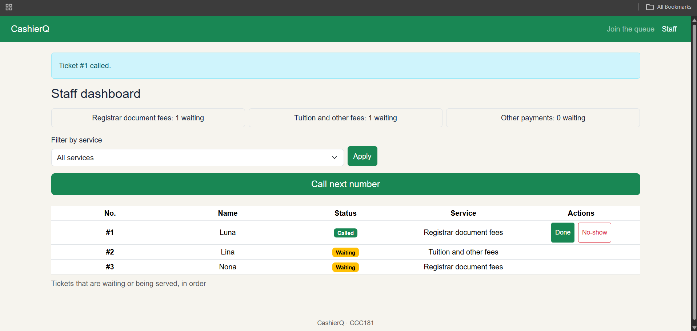
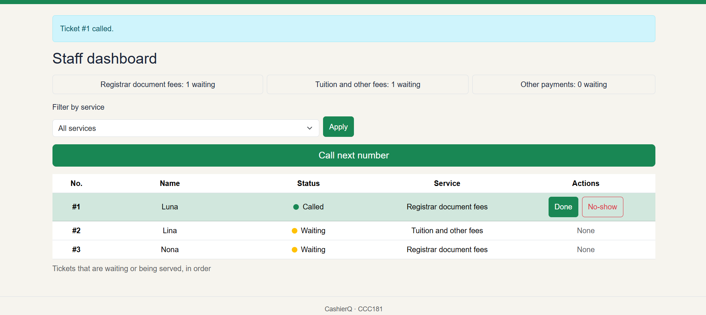

# Usability test

### 10a. Test with a real user 

**Tester:** 3rd year student

**Date:** October 25, 2026

**Device:** Laptop

## Task results

| Scenerio/Task | Finished? | Time | Hesitations | Which of your persona's rules held up and which did not |
|---|---|---|---|---|
| 1. "You just arrived. Get in line for CashierQ" | Yes | About 1 minute | None | Held up the persona Dona's number 4 rule where the short Join form (name, student ID, email, one service) was finished without help. | |
| 2. "How many people are ahead of you? What is your number?" | Yes | A few seconds  | None| Held up the persona Dona's number 1 rule where the ticket number and position were the biggest things on the page, so she found them right away. |
| 3. "Pretend you are the staff member. Call the next person and mark them as done."| Yes | 46 Seconds| A little as she was confused with the UI for a few seconds but eventually adopted| Partly held up the persona Teresa's rule number 1 and 3 as she completed both actions, but the hesitation shows that the Call next, Serve and No-show buttons weren't obvious enough at first glance. |

**Limit of this test:** it was done on a laptop, so Dona's phone-first rules (one hand free, number readable at a glance) were not tested on a small screen.

## 10b. One improvement

Problem: In Task 3, the tester hesitated for a few seconds on the staff dashboard. The Waiting and Called badges looked like buttons, and it wasn’t clear which row was the current one or what to click. The tester also rose the problem of the waiting status looking like an interactive button and voiced out that they were about to press it out of curiosity.

Fix: I changed the status of called and waiting from a word inside a box into a word with a circular color that represent its status to avoid looking like an interactive button. Additionally, I also added a word “None” in Actions for tickets with no buttons, so Done and No-show appear only where they apply.

**Before:**  

**After:**  

