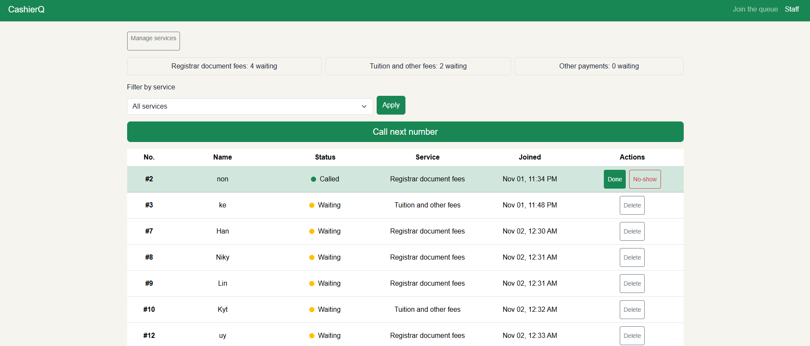
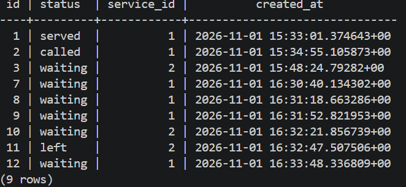
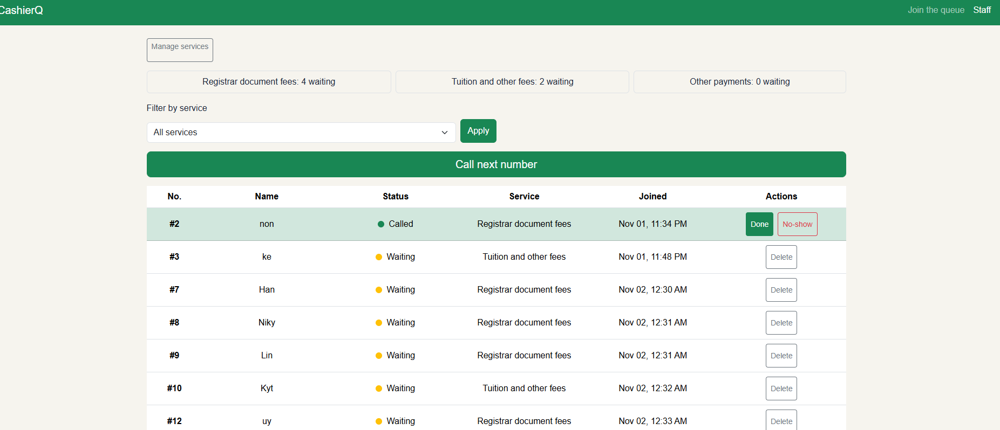
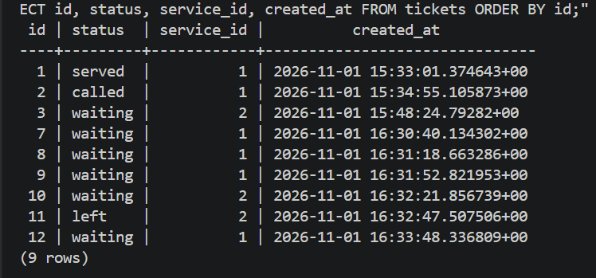

# Persistence

## Restart test

I started with 9 tickets across 2 services. One was served, one was called, one student had left the queue, and the rest were still waiting. Before touching anything, I took two screenshots: the staff dashboard, and the result of `SELECT id, status, service_id, created_at FROM tickets ORDER BY id;`.

Then I shut everything down. I stopped Flask with Ctrl+C and ran `docker compose down`, and `docker compose ps` showed nothing running. After that I ran `docker compose up -d`, waited until the database said `healthy`, started Flask again, and took the same two screenshots.

### Before

### After

## Result

Nothing changed. All 9 tickets came back with the same statuses and the same `created_at` times, and the dashboard showed the same waiting counts. The data lives in the `pgdata` volume, so `docker compose down` removes the container but not the tickets. The NFR-01 (no ticket is lost when the server or database restarts) passed.