# Week 4 Report: PostgreSQL Persistence for CashierQ

## 1. Title details

| | |
| --- | --- |
| **App name** | CashierQ |
| **Setting** | School cashier office, busiest during enrollment week |
| **Full name** | Pauline Fernan |
| **Student ID** | 2024-0037 |
| **Section** | CS3B |
| **Date** | 2 November 2026 |
| **Pull request** | [https://github.com/paulinefernan0901-dotcom/CCC181/pull/4](https://github.com/paulinefernan0901-dotcom/CCC181/pull/4) |

## 2. Requirements

I wrote **12 functional requirements** (FR-01 to FR-12) and **5 non-functional requirements** (NFR-01 to NFR-05) for this week's task. The full list, with priorities, a "Stores data?" column and statuses, is found in in [docs/requirements.md](../requirements.md).

**MVP:** FR-01, FR-02, FR-05, FR-06, FR-07, FR-08, FR-11, FR-12, plus NFR-01, NFR-02, NFR-03 and NFR-05. This is the smallest version of CashierQ that still solves the problem. A student can join from their phone, see their place in line, and know when they are called, while the cashier runs the whole queue from one dashboard. Tickets are also saved, so nobody loses their place when the app is stopped and started again.

**Feedback from a person in my setting:** I showed the functional requirements to a 3rd-year student who pays at the cashier. They suggested an alert that tells a student when only two students are ahead of them, so students can do other things while waiting and not miss their turn. They said everything else on the list is good because each function has a purpose, and their top three were FR-01, FR-05 and FR-07.

**What I changed:** I added no new requirements. The ticket page already shows the student's place and a "You're next!" message (FR-02, FR-03). Alerts that reach a student's device outside the page, such as SMS, email or phone notifications, are out of scope, so I kept the list as it is and added the suggestion to my out-of-scope list for a later version.

## 3. ERD

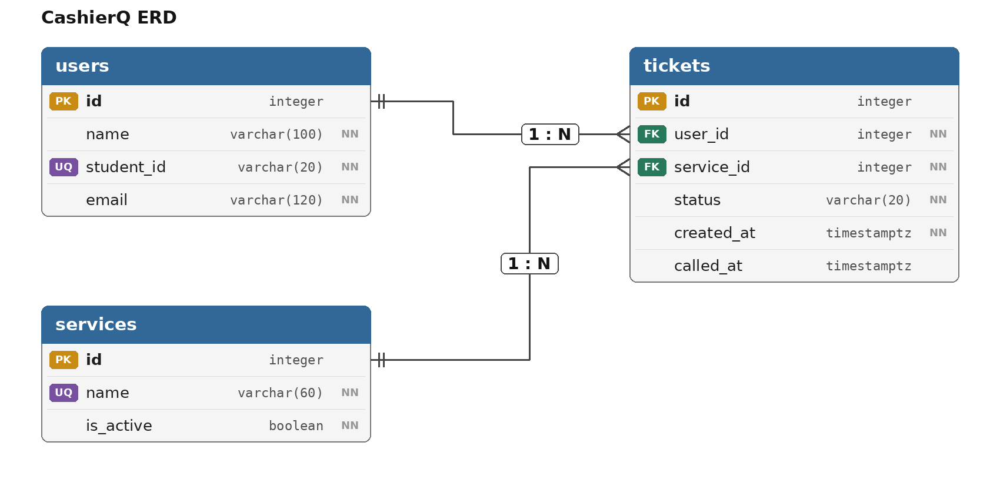

- One user has many tickets (1 : N). One service has many tickets (1 : N). Each ticket belongs to exactly one user and one service.
- The foreign keys, `tickets.user_id` and `tickets.service_id`, sit on the "many" side, which is the tickets table.
- Both foreign keys use `ON DELETE RESTRICT`, so a student or service that has tickets cannot be deleted and old tickets are never erased.

The full design, including the nouns table, the types and constraints, the delete rules and the normalization check, is in [schema.md](schema.md).

## 4. Schema

This is the output of `\d` for each table, taken from the running database.

```
                                      Table "public.users"
   Column   |          Type          | Collation | Nullable |              Default              
------------+------------------------+-----------+----------+-----------------------------------
 id         | integer                |           | not null | nextval('users_id_seq'::regclass)
 name       | character varying(100) |           | not null | 
 student_id | character varying(20)  |           | not null | 
 email      | character varying(120) |           | not null | 
Indexes:
    "users_pkey" PRIMARY KEY, btree (id)
    "users_student_id_key" UNIQUE CONSTRAINT, btree (student_id)
Check constraints:
    "ck_users_email" CHECK (POSITION(('@'::text) IN (email)) > 1)
    "ck_users_student_id" CHECK (student_id::text ~ '^[0-9]{4}-[0-9]{4}$'::text)
Referenced by:
    TABLE "tickets" CONSTRAINT "tickets_user_id_fkey" FOREIGN KEY (user_id) REFERENCES users(id) ON DELETE RESTRICT
```

```
                                     Table "public.services"
  Column   |         Type          | Collation | Nullable |               Default                
-----------+-----------------------+-----------+----------+--------------------------------------
 id        | integer               |           | not null | nextval('services_id_seq'::regclass)
 name      | character varying(60) |           | not null | 
 is_active | boolean               |           | not null | true
Indexes:
    "services_pkey" PRIMARY KEY, btree (id)
    "services_name_key" UNIQUE CONSTRAINT, btree (name)
Referenced by:
    TABLE "tickets" CONSTRAINT "tickets_service_id_fkey" FOREIGN KEY (service_id) REFERENCES services(id) ON DELETE RESTRICT
```

```
                                       Table "public.tickets"
   Column   |           Type           | Collation | Nullable |               Default               
------------+--------------------------+-----------+----------+-------------------------------------
 id         | integer                  |           | not null | nextval('tickets_id_seq'::regclass)
 status     | character varying(20)    |           | not null | 'waiting'::character varying
 created_at | timestamp with time zone |           | not null | now()
 called_at  | timestamp with time zone |           |          | 
 user_id    | integer                  |           | not null | 
 service_id | integer                  |           | not null | 
Indexes:
    "tickets_pkey" PRIMARY KEY, btree (id)
    "uq_tickets_active_user_service" UNIQUE, btree (user_id, service_id) WHERE status::text = ANY (ARRAY['waiting'::character varying, 'called'::character varying]::text[])
Check constraints:
    "ck_tickets_called_at" CHECK ((status::text = ANY (ARRAY['called'::character varying, 'served'::character varying, 'no-show'::character varying]::text[])) = (called_at IS NOT NULL))
    "ck_tickets_status" CHECK (status::text = ANY (ARRAY['waiting'::character varying, 'called'::character varying, 'served'::character varying, 'no-show'::character varying, 'left'::character varying]::text[]))
Foreign-key constraints:
    "tickets_service_id_fkey" FOREIGN KEY (service_id) REFERENCES services(id) ON DELETE RESTRICT
    "tickets_user_id_fkey" FOREIGN KEY (user_id) REFERENCES users(id) ON DELETE RESTRICT
```

## 5. Design decisions

**1. Services are their own table with an `is_active` column (FR-11, FR-12).** The cashier handles three kinds of payments and needs to add, rename and switch off services. Storing each service name once means a rename updates one row and every old ticket follows it. Switching a service off with `is_active` hides it from the join form without deleting it, so old tickets keep their service, which is why the foreign key uses `RESTRICT`.

**2. A student can only hold one active ticket per service, enforced by the database (Dona's persona, FR-01).** Dona usually has one hand busy and a slow connection, so a repeated tap or a second tab is a real risk. The join button already locks after one tap, but that only protects the browser. I added a partial unique index on `(user_id, service_id)` that applies only while a ticket is waiting or called, so the database refuses a second active ticket even if the browser check fails. A student can still join a different service, or the same one again after being served.

**3. Leaving the queue and no-show are separate statuses, and `called_at` is kept (Teresa's persona, FR-04, FR-08).** Teresa's frustration is not knowing whether a student left or just did not hear her. A ticket that is `left` was never called, and a `no-show` was called and never came, so the two are kept apart for reports. A CHECK ties `called_at` to the status, so a ticket has a call time exactly when it has been called. Position in line, people ahead and waiting times are never stored. They are worked out from `created_at`, `called_at` and `status`.

## 6. Self-review

The full review is in [schema-review.md](schema-review.md). The main problems I found were:

- **An unused column.** `users.email` is collected in FR-01, but no requirement uses it. I decided to keep it because the join form already collects it and checks it.
- **Duplicate tickets.** The join button locks in the browser, but nothing in the database stopped a student from holding two waiting tickets for the same service by using two tabs or devices. I added the partial unique index described above.
- **Status and call time could disagree.** A ticket could have the status `called` with an empty `called_at`, or `waiting` with a call time. I added a CHECK so `called_at` is filled in exactly when the status is called, served or no-show.

The ERD stayed the same, because the diagram does not show CHECK rules or indexes. I also added a student ID format rule to `schema.md` so it matches the database.

## 7. Migrations

| Migration | What it does |
| --- | --- |
| `97c40e14454a` (initial tables) | Creates the `users`, `services` and `tickets` tables with their keys, constraints and the partial unique index. |
| `d22f5723e1d0` (student ID format check) | Adds a CHECK on `users.student_id` so only IDs in the form `2023-1234` are accepted. |

Both are in `migrations/versions/` and are committed with the code. `flask --app app db upgrade` followed by `flask --app app seed` rebuilds the whole database on any computer.

## 8. CRUD

| Operation | Route | Requirement | Screenshot |
| --- | --- | --- | --- |
| **Create** | `POST /join` | FR-01 | 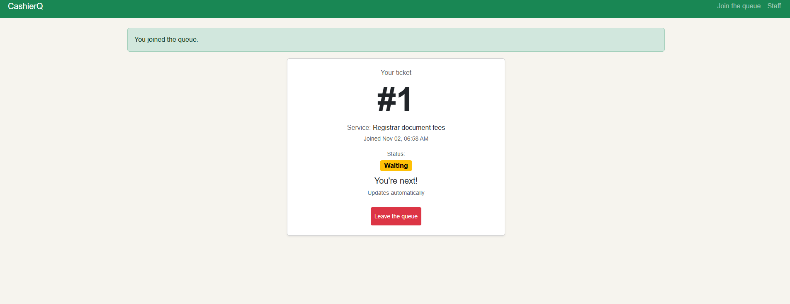 |
| **Read** | `GET /staff` (`staff_dashboard`) | FR-05 | 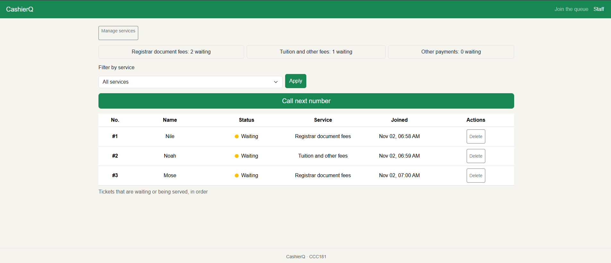 |
| **Update** | `POST /staff/tickets/<id>/<action>` (`staff_action`) | FR-06 | 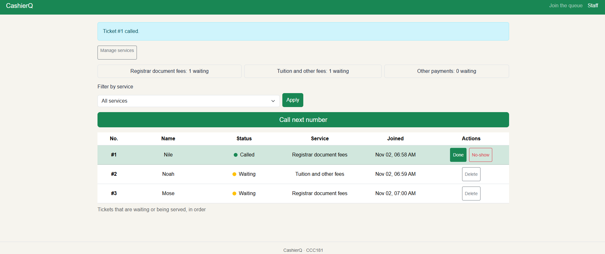 |
| **Soft delete** | `POST /queue/<id>/leave` (`leave`) | FR-04 | 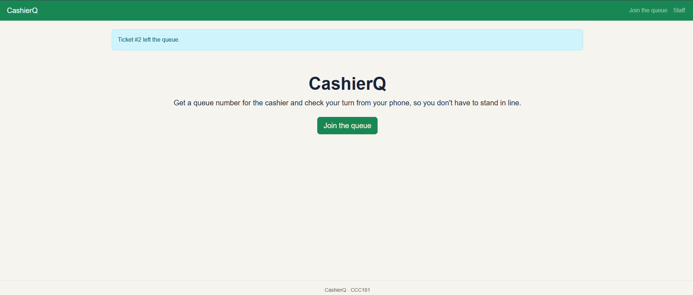 |
| **Hard delete** | `POST /staff/services/<id>/delete` (`service_delete`) | FR-12 | 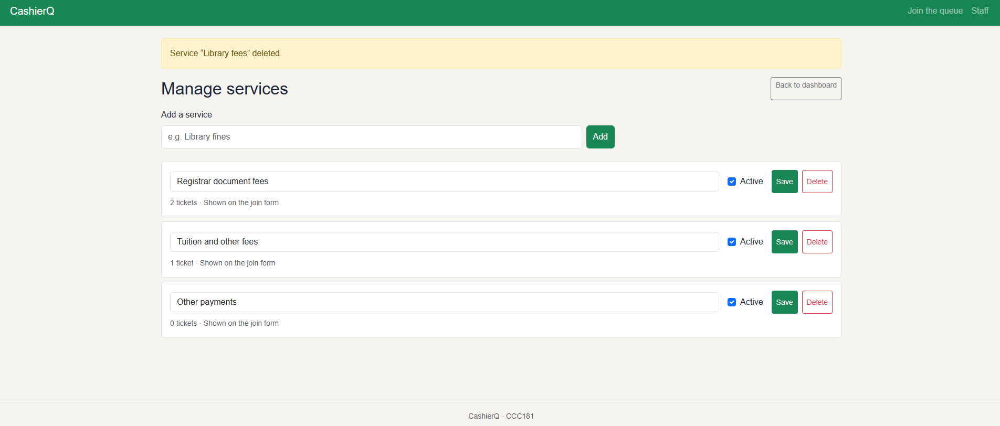 |

- **Create:** a student fills in the join form and gets a ticket number.
- **Read:** the staff dashboard lists the waiting tickets in order with a count for each service.
- **Update:** the cashier calls a ticket, which changes its status and fills in `called_at`.
- **Soft delete:** leaving the queue keeps the row and sets its status to `left`. The query below shows ticket #2 still in the database.

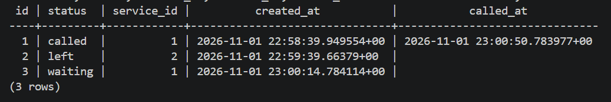

- **Hard delete:** a service with no tickets can be deleted for good. A service that has tickets is refused, because of `RESTRICT`.

## 9. Validation

I tested each rule where it lives, and the full results are in [validation.md](validation.md). In Flask, I skipped the form on purpose by sending `curl` requests straight to `/join`. All four bad requests (an empty name, a student ID like `abcd`, an email like `not-an-email`, and a service that does not exist) returned 400 and saved nothing. In PostgreSQL, I skipped Flask on purpose by typing statements in `psql`, and all nine bad statements were refused, covering a foreign key, CHECK rules, UNIQUE, NOT NULL, the partial unique index and RESTRICT. I also checked that a ticket added with only a user and a service gets its `status` and `created_at` from the database defaults, and a `git grep` for SQL inside f-strings printed nothing, so every query goes through SQLAlchemy.

## 10. Persistence

I started with 9 tickets across 2 services. One was served, one was called, one student had left the queue, and the rest were still waiting. I took a screenshot of the staff dashboard and of `SELECT id, status, service_id, created_at FROM tickets ORDER BY id;`, stopped Flask, ran `docker compose down`, then ran `docker compose up -d`, waited until the database was healthy, and started Flask again.

| Before the restart | After the restart |
| --- | --- |
| 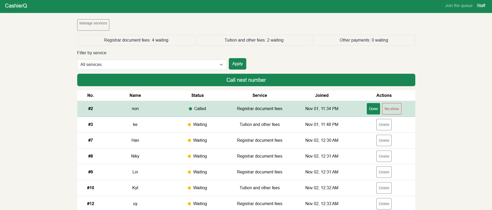 | 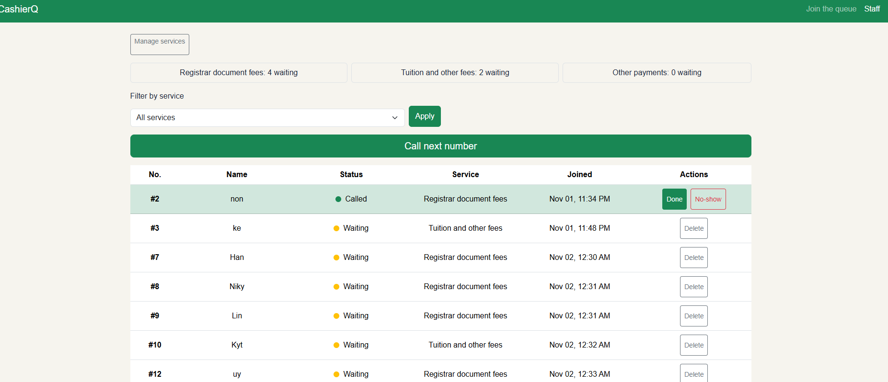 |
| 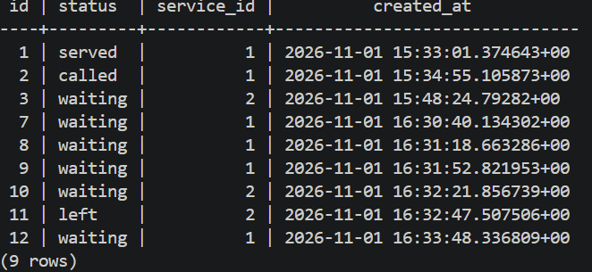 | 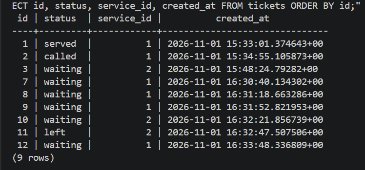 |

All 9 tickets came back with the same statuses and the same `created_at` times. The data lives in the `pgdata` volume, so `docker compose down` removes the container but not the tickets.

**Rebuild from scratch:** I ran `docker compose down -v`, `docker compose up -d`, `flask --app app db upgrade` and `flask --app app seed`. Both migrations ran in order, the seed added my three services, and the app opened, showed the services on the join form and let me join the queue. The migrations and the seed command are enough to rebuild my database on any computer.

**NFR-05 (no ticket is lost when Flask or the database restarts) passed.** The full steps are in [persistence.md](persistence.md).

## 11. Reflection

**What was hardest this week:** The hardest part was implementing the code and the SQL. Each change from Part 5 to Part 8 sometimes stopped the app from running or caused errors, so I had to debug several times before it worked again.

**The requirement that was hardest to write in a testable way:** FR-12, where the cashier can add, rename and switch off a service. "Switch off" was the hard part, because it needed a clear result that someone else could check. I defined it as the service disappearing from the join form while the tickets it already has keep it.

**A report my staff persona would want:** Teresa would want to see the busiest hours of the day. It can be worked out from when tickets are created (`created_at`), and it would help her know when to expect long lines.

## 12. Declaration

I used Claude to help me draft and reword my requirements and ask for assistance as I go through each part of the task. This week introduced new things such as Docker, PostgreSQL and migrations, so I also asked Claude to explain concepts like constraints, migrations and normalization, and to help me understand why certain things work. I made the decisions about my own design, tested the app, took the screenshots and checked the results myself.
