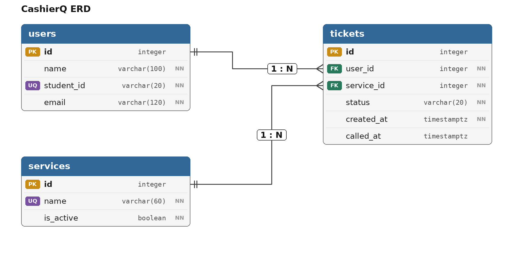

### 2a. Find the nouns in your requirements

| Req ID | Requirement | Nouns | Table or column? |
| --- | --- | --- | --- |
| FR-01 | A **student** can join the **queue** by entering their **name**, **student ID**, **email** and the **service** they are paying for. | student, queue, name, student ID, email, service | users, *(not a table)*, users.name, users.student_id, users.email, services |
| FR-02 | A student can see their **ticket number** and how many people are **ahead** of them. | ticket number, ahead | tickets.id, *(computed)* |
| FR-04 | A student can **leave** the queue before being called. | leave | tickets.status = 'left' |
| FR-05 | A **cashier** can see the **waiting tickets** in **order**. | cashier, waiting tickets, order | *(no table, no login yet)*, tickets with status 'waiting', tickets.created_at |
| FR-06 | A cashier can **call** the next ticket, and the **called number** is shown. | call, called number | tickets.status = 'called', tickets.called_at |
| FR-07 | A cashier can mark a ticket as **served**. | served | tickets.status = 'served' |
| FR-08 | A cashier can mark a ticket as **no-show**. | no-show | tickets.status = 'no-show' |
| FR-11 | A student can choose one of three cashier **services**. | services | services.name |
| FR-12 | A cashier can **add**, **rename** and **switch off** a service. | name, switched off | services.name, services.is_active |

### 2b. Tables and columns

| Table | Columns |
| --- | --- |
| `users` | id, name, student_id, email |
| `services` | id, name, is_active |
| `tickets` | id, user_id, service_id, status, created_at, called_at |

### 2c. Types and constraints

| Table | Column | PostgreSQL type | Constraint | Why |
| --- | --- | --- | --- | --- |
| users | id | integer, generated | PRIMARY KEY | Generated by the database, never reused |
| users | name | varchar(100) | NOT NULL | Cashier needs a name to call |
| users | student_id | varchar(20) | NOT NULL UNIQUE | One row per student; text, so leading zeros are kept |
| users | email | varchar(120) | NOT NULL, CHECK (position('@' in email) > 1) | Rejects emails with no @ |
| users | student_id | varchar(20) | CHECK (student_id ~ '^[0-9]{4}-[0-9]{4}$') | Only IDs in the school's format, like 2023-1234, are accepted |
| services | id | integer, generated | PRIMARY KEY | Generated by the database, never reused |
| services | name | varchar(60) | NOT NULL UNIQUE | No two services with the same name |
| services | is_active | boolean | NOT NULL DEFAULT true | Lets the cashier switch a service off without deleting it |
| tickets | id | integer, generated | PRIMARY KEY | The ticket number; never reused |
| tickets | user_id | integer | NOT NULL REFERENCES users(id) | No ticket for a missing student |
| tickets | service_id | integer | NOT NULL REFERENCES services(id) | No ticket for a missing service |
| tickets | status | varchar(20) | NOT NULL DEFAULT 'waiting', CHECK (status IN ('waiting', 'called', 'served', 'no-show', 'left')) | Only these five statuses are allowed |
| tickets | created_at | timestamptz | NOT NULL DEFAULT now() | Time zone safe; set by the database |
| tickets | called_at | timestamptz | *(none; empty until called)* | Only has a value once the cashier calls the ticket |
| tickets | user_id, service_id | *no type* | UNIQUE index on (user_id, service_id) WHERE status IN ('waiting', 'called') | A student can't hold two active tickets for the same service, but can still join a different service |
| tickets | status, called_at | *no type* | CHECK ((status IN ('called', 'served', 'no-show')) = (called_at IS NOT NULL)) | `called_at` is filled in exactly when the ticket has been called |

### 2d. Relationships

- One user has many tickets (1 : N). One service has many tickets (1 : N). Each ticket belongs to exactly one user and one service.
- The foreign keys, `tickets.user_id` and `tickets.service_id`, sit on the "many" side, which is the tickets table.

### Delete rules

| Foreign key | On delete | Why |
| --- | --- | --- |
| tickets.user_id → users.id | RESTRICT | A student who has tickets can't be deleted, because the old tickets are needed for reports. |
| tickets.service_id → services.id | RESTRICT | A service with tickets can't be deleted. The cashier switches it off with `is_active` instead, so old tickets keep their service. |

### 2e. Normalization check

1. **One value per cell (1NF):** No. Every column holds a single value. A ticket has one `service_id`, one `status` out of five allowed values, and one `created_at`. Nothing is stored as a list like "Registrar, Tuition".

2. **Depends on the whole key (2NF):** Not applicable, because CashierQ has no join table. All three tables have a single-column primary key (`id`), so every other column depends on the whole key by default. There is no many-to-many relationship, since each ticket is for exactly one service.

3. **No hidden copies (3NF):** No. A student's name, student ID and email are stored only once, in `users`, and a ticket points to them with `user_id` instead of copying them. A service's name is stored only once, in `services`, and tickets point to it with `service_id`. If a student's email or a service's name changes, I only have to update one row. The position in line is not stored at all, since it is computed from `created_at`.